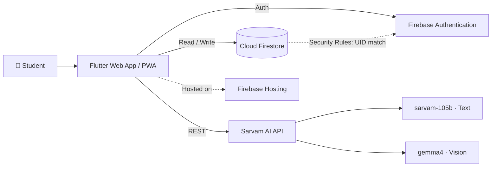

<div align="center">

# 🎓 Academic Nexus

### The data-driven student dashboard that tells you exactly what it takes to hit your target SGPA.

[](https://academic-nexus-db32d.web.app)


[Live Demo](https://academic-nexus-db32d.web.app) · [Features](#-features) · [Getting Started](#-getting-started) · [Deployment](#%EF%B8%8F-deployment) · [Security](#-security)

</div>

---

## 📖 Overview

**Academic Nexus** is a student dashboard built around a **dynamic SGPA target tracker**. Instead of only reporting where you stand, it works backwards from your goal and calculates the grades, credit weightings, and milestones needed to reach your target Semester Grade Point Average.

Around that core, the platform adds a multimodal AI tutor, real-time attendance tracking, and private cloud storage, so everything a student needs for the semester lives in one place.

<!--
  📸 Add screenshots here once available, e.g.:
  <p align="center">
    
    
  </p>
-->

---

## ✨ Features

| | Feature | Description |
|---|---|---|
| 🎯 | **Dynamic SGPA Target Tracker** | The algorithmic core of the app. Calculates and tracks the exact grades, credit weightings, and milestones required to hit your target SGPA. |
| 🤖 | **Multimodal AI Advisor** | Powered by Sarvam AI (`sarvam-105b` for text, `gemma4` for vision). Upload screenshots of assignments or notes and get complex concepts broken down step by step. |
| 📊 | **Proactive Attendance Tracking** | Compares target vs. current attendance per subject and instantly calculates your "safe to miss" limit. |
| 🔐 | **Secure Private Vaults** | Each user gets an isolated data space on Cloud Firestore, protected by backend Security Rules and persisted permanently. |
| 🌐 | **Cross-Platform Ready** | Flutter frontend compiled for the web with Progressive Web App (PWA) support. |

---

## 🧱 Architecture



---

## 🛠 Tech Stack

| Layer | Technology |
|---|---|
| **Frontend** | Flutter (Dart) |
| **Backend as a Service** | Firebase: Authentication, Cloud Firestore, Hosting |
| **AI Integration** | Sarvam AI REST API (multimodal endpoints) |
| **Configuration** | `flutter_dotenv` |

---

## 🚀 Getting Started

### Prerequisites

- [Flutter SDK](https://docs.flutter.dev/get-started/install) (latest stable)
- [Firebase CLI](https://firebase.google.com/docs/cli)
- A [Sarvam AI](https://www.sarvam.ai/) API key

### Installation

**1. Clone the repository**

```bash
git clone https://github.com/Krishna2006-babu/academic-nexus.git
cd academic-nexus
```

**2. Install dependencies**

```bash
flutter pub get
```

**3. Configure environment variables**

Create an `assets/.env` file (create the `assets` folder if it doesn't exist):

```env
SARVAM_API_KEY=your_api_key_here
```

> [!NOTE]
> `assets/.env` is listed in `.gitignore` so it is never committed to version control.

**4. Run locally**

```bash
flutter run -d edge
```

> Replace `edge` with `chrome` or any other supported web device.

---

## ☁️ Deployment

The project is configured for **Firebase Hosting**.

```bash
# 1. Clean and build the production web bundle
flutter clean
flutter build web

# 2. Deploy
firebase deploy --only hosting
```

> [!TIP]
> After deploying, do a hard refresh (`Ctrl + F5`) to clear the Service Worker cache and load the latest version.

---

## 🔒 Security

- **Isolated user data:** Firestore Security Rules only allow a user to read or write document paths that match their verified Firebase Authentication UID.
- **Secrets out of version control:** The Sarvam API key lives in `assets/.env`, which is git-ignored and never appears in the repository history.

> [!WARNING]
> Files declared under Flutter `assets` are bundled into the built web app, so a key loaded this way can be read by anyone who inspects the deployed site. For a public deployment, route AI requests through a backend (for example Firebase Cloud Functions) that holds the key server-side, and restrict or rotate the key if it has been exposed.

---

## 🤝 Contributing

Contributions, issues, and feature requests are welcome.

1. Fork the repository
2. Create a feature branch (`git checkout -b feature/your-feature`)
3. Commit your changes (`git commit -m "Add your feature"`)
4. Push to the branch (`git push origin feature/your-feature`)
5. Open a Pull Request

---

## 👨‍💻 Author

**Krishna Sharma**
B.Tech, Electronics and Communication Engineering · NIT Silchar

[](https://github.com/Krishna2006-babu)

---

<div align="center">

⭐ If you find this project useful, consider giving it a star!

</div>
