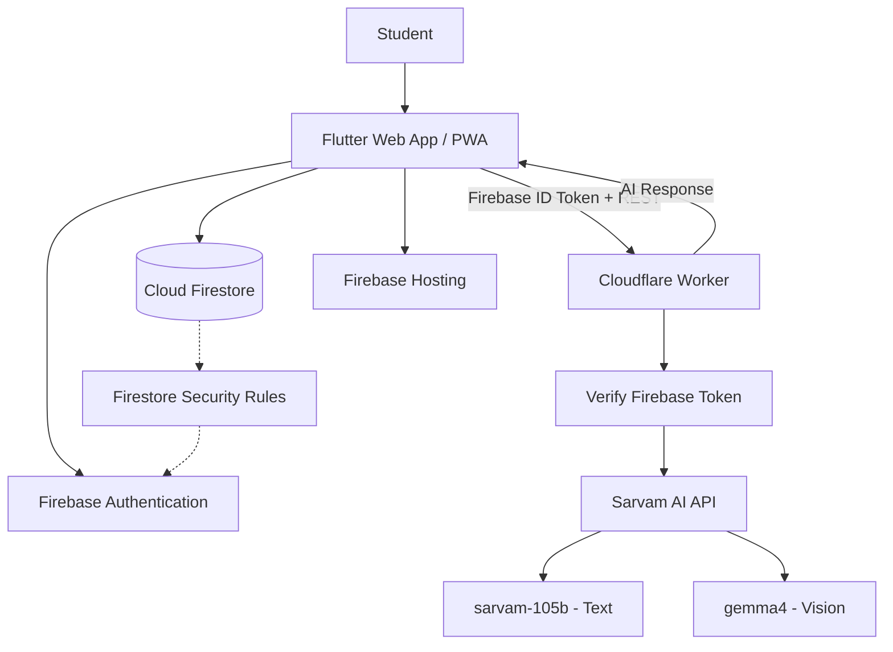

<div align="center">

# 🎓 Academic Nexus

### The data-driven student dashboard that tells you exactly what it takes to hit your target SGPA.

[![Live Demo]\([https://img.shields.io/badge/Live_Demo-Visit_App-2ea44f?style=for-the-badge&logo=firebase&logoColor=white)\](https://academic-nexus-db32d.web.app](https://img.shields.io/badge/Live_Demo-Visit_App-2ea44f?style=for-the-badge\&logo=firebase\&logoColor=white\)]\(https://academic-nexus-db32d.web.app))

![Flutter]\([https://img.shields.io/badge/Flutter-02569B?style=flat-square&logo=flutter&logoColor=white](https://img.shields.io/badge/Flutter-02569B?style=flat-square\&logo=flutter\&logoColor=white))
![Dart]\([https://img.shields.io/badge/Dart-0175C2?style=flat-square&logo=dart&logoColor=white](https://img.shields.io/badge/Dart-0175C2?style=flat-square\&logo=dart\&logoColor=white))
![Firebase]\([https://img.shields.io/badge/Firebase-FFCA28?style=flat-square&logo=firebase&logoColor=black](https://img.shields.io/badge/Firebase-FFCA28?style=flat-square\&logo=firebase\&logoColor=black))
![Sarvam AI]\([https://img.shields.io/badge/Sarvam_AI-1E1E1E?style=flat-square&logo=openai&logoColor=white](https://img.shields.io/badge/Sarvam_AI-1E1E1E?style=flat-square\&logo=openai\&logoColor=white))
![PWA]\([https://img.shields.io/badge/PWA-5A0FC8?style=flat-square&logo=pwa&logoColor=white](https://img.shields.io/badge/PWA-5A0FC8?style=flat-square\&logo=pwa\&logoColor=white))

[Live Demo]\([https://academic-nexus-db32d.web.app](https://academic-nexus-db32d.web.app)) · [Features]\(#-features) · [Getting Started]\(#-getting-started) · [Deployment]\(#%EF%B8%8F-deployment) · [Security]\(#-security)

</div>

---

## 📖 Overview

**Academic Nexus** is a comprehensive student management platform built around a dynamic SGPA target-tracking system.

Rather than simply displaying academic performance, it helps students work backwards from their desired SGPA and understand what academic performance they need to achieve their goals.

The platform combines academic planning, attendance management, personal study resources, and a multimodal AI companion into one unified dashboard.

Its AI assistant, **Nexus**, goes beyond conventional academic chatbots. It acts as a supportive, personalized companion that understands student context, provides emotional support, and assists with academic queries, study planning, and image-based questions.

---

## ✨ Features

| Feature | Description |
|---|---|
| 🎯 **Dynamic SGPA Planner** | Calculates the grade requirements needed to achieve a target SGPA using subject credits and difficulty weights. |
| 🤖 **Multimodal AI Companion** | Nexus uses Sarvam AI models for conversational assistance and image-based queries. |
| 📊 **Smart Attendance Tracker** | Tracks subject-wise attendance, calculates attendance percentages, and determines how many classes a student can safely miss. |
| 📚 **Study Vault** | Organizes semester-wise notes, syllabi, and previous-year question papers, with offline caching support. |
| 📅 **Daily Planner** | Helps students organize daily academic tasks and maintain productivity. |
| 📈 **Academic Dashboard** | Provides a centralized view of academic progress and important student information. |
| 🔐 **Private Student Accounts** | Firebase Authentication and Firestore Security Rules ensure user-specific data isolation. |
| 🌐 **Cross-Platform Access** | Flutter Web application with Progressive Web App (PWA) support. |

---

## 🎯 Dynamic SGPA Planner

The SGPA planner is one of the core algorithmic components of Academic Nexus.

Instead of merely calculating the current SGPA, it helps students determine the grades required to reach a desired target.

Key considerations:

- Subject-wise credit distribution.
- Difficulty classification: Easy, Medium, and Hard.
- Required grade allocation based on subject difficulty.
- Target SGPA calculation and academic progress tracking.

The algorithm considers the relative difficulty of subjects when distributing grade requirements, helping students create a more practical academic strategy.

---

## 🤖 Nexus – AI Companion

Nexus is an integrated AI assistant designed to provide personalized assistance beyond traditional academic chatbots.

### Capabilities

- Natural conversational interactions.
- Context-aware responses using student information.
- Supportive conversations and personalized guidance.
- Academic concept explanations.
- Assignment and study-related assistance.
- Image-based question answering through uploaded images.

### AI Models

| Model | Purpose |
|---|---|
| `sarvam-105b` | Text-based conversational assistance. |
| `gemma4` | Multimodal image understanding and image-based queries. |

### Secure AI Integration

AI requests are routed through a dedicated Cloudflare Worker backend instead of directly exposing the Sarvam API key in the Flutter application.

The backend handles authentication, request validation, and communication with Sarvam AI.

---

## 🏗 Architecture

Academic Nexus uses Firebase as its Backend-as-a-Service platform and Cloudflare Workers as a dedicated server-side layer for AI integration.



### Architecture Overview

**Frontend – Flutter**

- Built using Flutter and Dart.
- Provides the student dashboard and application interface.
- Communicates with Firebase services.
- Sends AI requests to the dedicated backend.

**Authentication and Database – Firebase**

- Firebase Authentication handles user authentication.
- Cloud Firestore stores student-specific information.
- Firestore Security Rules enforce user-level data isolation.

**AI Backend – Cloudflare Workers**

- Acts as a secure intermediary between Flutter and Sarvam AI.
- Validates Firebase authentication tokens.
- Keeps the Sarvam API key server-side using Cloudflare secrets.
- Routes text and image requests to the appropriate AI models.
- Returns generated responses to the Flutter application.

**Hosting – Firebase Hosting**

- Hosts the production Flutter Web application.
- Provides access to the application through its live URL.

---

## 🛠 Tech Stack

| Layer | Technologies |
|---|---|
| Frontend | Flutter, Dart |
| Authentication | Firebase Authentication |
| Database | Cloud Firestore |
| AI Backend | Cloudflare Workers, JavaScript |
| AI Integration | Sarvam AI REST API |
| AI Models | sarvam-105b, gemma4 |
| Frontend Hosting | Firebase Hosting |
| Backend Deployment | Cloudflare Workers |
| Application Format | Flutter Web, PWA |

---

## 🚀 Getting Started

### Prerequisites

- [Flutter SDK](https://docs.flutter.dev/get-started/install)
- [Firebase CLI](https://firebase.google.com/docs/cli)
- Firebase project
- Cloudflare account (for AI backend deployment)
- Sarvam AI API key

### 1. Clone the repository

```bash
git clone https://github.com/Krishna2006-babu/academic-nexus.git

cd academic-nexus
```

### 2. Install dependencies

```bash
flutter pub get
```

### 3. Configure Firebase

Configure your Firebase project and ensure Firebase Authentication and Cloud Firestore are enabled.

Set up the appropriate Firebase configuration for your Flutter application.

### 4. Run locally

```bash
flutter run -d edge
```

You can replace `edge` with `chrome` or another supported Flutter device.

---

## ☁️ AI Backend Setup

The AI backend is maintained separately in the `academic-nexus-ai` Cloudflare Worker project.

### 1. Configure the backend

Clone or open the AI backend repository and install the required dependencies.

### 2. Configure the API secret

Store the Sarvam API key as a Cloudflare Worker secret:

```bash
npx wrangler secret put SARVAM_API_KEY
```

Enter your API key when prompted.

The key is stored server-side and is not included in the Flutter application's production bundle.

### 3. Deploy the Worker

```bash
npx wrangler deploy
```

### 4. Backend endpoint

The deployed AI backend is available at:

```text
https://academic-nexus-ai.academic-nexus-ai-krishna.workers.dev
```

The Worker exposes a health-check endpoint and accepts authenticated AI requests from the Flutter application.

---

## 🚀 Deployment

### Frontend Deployment

Build the production Flutter Web application:

```bash
flutter clean
flutter pub get
flutter build web
```

Deploy to Firebase Hosting:

```bash
firebase deploy --only hosting
```

### AI Backend Deployment

Navigate to the Cloudflare Worker project and run:

```bash
npx wrangler deploy
```

The frontend and AI backend are deployed independently.

---

## 🔒 Security

Security is an important part of Academic Nexus.

### Firebase Authentication

Users authenticate through Firebase Authentication. AI requests carry a Firebase ID token for backend verification.

### Firestore Data Isolation

Firestore Security Rules restrict access to user-specific documents based on the authenticated user's UID.

### Server-Side API Key Management

The Sarvam API key is stored as a Cloudflare Worker secret rather than being embedded in Flutter assets or exposed in the web application's JavaScript bundle.

### Backend Request Validation

The Cloudflare Worker validates authentication and incoming requests before forwarding them to the AI provider.

This architecture separates frontend application code from sensitive AI credentials and provides a dedicated backend layer for AI communication.

---

## 🌐 Live Application

**Academic Nexus:** https://academic-nexus-db32d.web.app

**AI Backend:** https://academic-nexus-ai.academic-nexus-ai-krishna.workers.dev

---

## 🤝 Contributing

Contributions, issues, and feature requests are welcome.

1. Fork the repository.
2. Create a feature branch.
3. Commit your changes.
4. Push the branch.
5. Open a Pull Request.

---

## 👨‍💻 Author

**Krishna Sharma**

B.Tech, Electronics and Communication Engineering  
National Institute of Technology Silchar

[GitHub – Krishna2006-babu](https://github.com/Krishna2006-babu)

---

<p align="center">
  ⭐ If you find Academic Nexus useful, consider giving the repository a star!
</p>